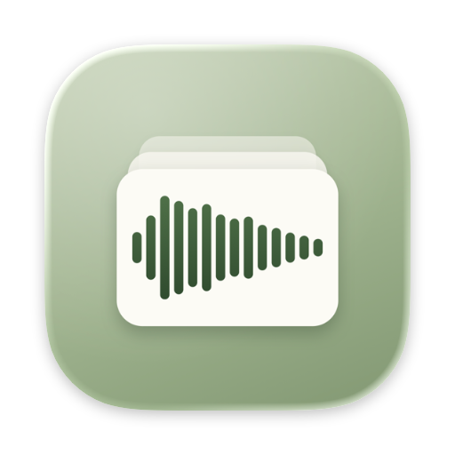
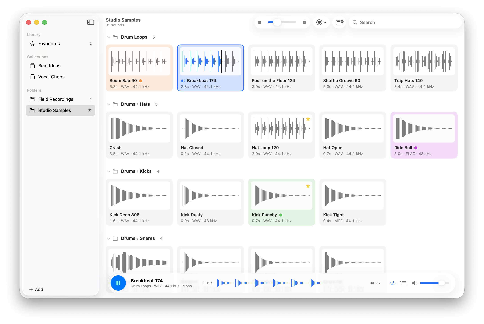

<p align="center">
  
</p>

<h1 align="center">SoundBin</h1>

<p align="center">
  A fast, native sound browser for macOS.<br>
  Point it at a folder of sounds and see every file as a waveform. Click one to hear it.
</p>

<p align="center">
  <a href="https://github.com/RocketBill/SoundBin/releases/latest">Download</a> ·
  macOS 26 or later ·
  Free and open source
</p>

<p align="center">
  <picture>
    <source media="(prefers-color-scheme: dark)" srcset="Docs/screenshot-dark.png">
    
  </picture>
</p>

## Features

### Browse

- **Waveform grid.** Every sound is a tile showing its waveform, name, length and format. Drag the toolbar slider or press ⌘+ / ⌘− to resize the tiles.
- **Subfolders.** Include subfolders (on by default) to see a whole library at once, grouped into collapsible sections by folder.
- **Search, sort and filter.** Filter by name or colour label, and sort by name, duration, date modified, size or format.
- **Artwork.** MP3s, M4As and other files with embedded cover art can show it on their tiles.
- **Stays up to date.** Folders are watched, so new and deleted files show up automatically.
- **Quick to reopen.** Waveforms and artwork are cached, so folders open instantly next time.

### Listen

- **Instant playback.** Click a tile to play it, or move through them with the arrow keys and hear each one as you go. Space plays or stops.
- **Loop and Play Next.** Press ⌘L to loop a sound, or turn on Play Next Automatically to carry on to the next sound when one ends.
- **Transport bar.** See where you are in the current sound, and click its waveform to jump around.

### Organise

- **Favourites.** Star the sounds you keep coming back to (or press Full Stop) and find them all in one place, wherever they live on disk.
- **Collections.** Group sounds from any of your folders into collections, such as everything for one track. When you're ready, make a collection into a real folder on disk.
- **Colour labels.** Tag sounds with Finder-style colours using ⌥⌘1 to ⌥⌘7, and name each colour after how you sort, such as Kicks or Vocals.
- **Drag out.** Drag tiles straight into your DAW, Finder or anywhere else that accepts audio files.

SoundBin plays anything macOS can decode, including WAV, AIFF, MP3, M4A/AAC, ALAC, FLAC and CAF.

## Installing

Download the latest version from [Releases](https://github.com/RocketBill/SoundBin/releases/latest), open the disk image and drag SoundBin into your Applications folder. Open it from there: SoundBin can't update itself while it's running from the disk image or your Downloads folder.

SoundBin checks for new versions daily and offers to install them. You can turn this off, or have updates install themselves, in Settings.

## Building from source

1. Clone the repo:
   ```sh
   git clone https://github.com/RocketBill/SoundBin.git
   ```
2. Open `SoundBin.xcodeproj` in Xcode 26 or later.
3. In the SoundBin target's **Signing & Capabilities** tab, choose your own team.
4. Build and run (⌘R).

The only dependency is [Sparkle](https://sparkle-project.org), for updates, which Xcode fetches automatically through Swift Package Manager.

## Releasing

`Tools/release.sh` builds a release, signs it with Developer ID, notarizes it and publishes it as a GitHub release: a disk image, plus the signed Sparkle feed that existing copies check for updates. Run it with `--dry-run` first to do everything except publishing. The setup it needs, and how to bump versions, is described at the top of the script.

## Privacy

SoundBin runs in the App Sandbox. It only reads the folders you choose, and only writes to disk when you ask it to, such as making a collection into a new folder. It never modifies, moves or uploads your sounds. Its only network connection is the daily update check against this repository's GitHub releases, which you can turn off in Settings. The app itself has no network access: a separate helper from Sparkle does the downloading.

## Licence

SoundBin is free and open source under the [MIT Licence](LICENSE).
